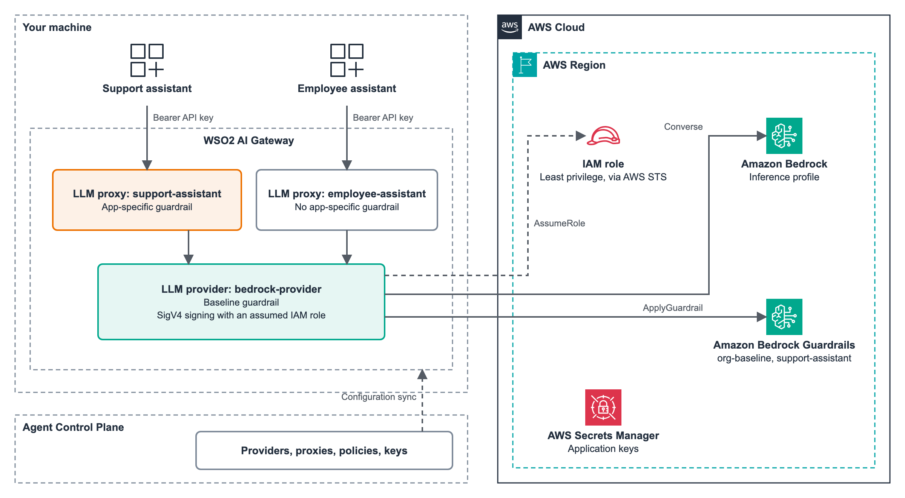

# Safeguard LLM traffic with Amazon Bedrock Guardrails and WSO2 AI Gateway

Sample code for the AWS Machine Learning Blog post *Safeguard LLM traffic with Amazon Bedrock Guardrails and WSO2 AI Gateway*.

- **AWS side, as code:** Terraform creates two Amazon Bedrock guardrails (an organization baseline and a support-assistant guardrail), their versions, and a least-privilege IAM role for the gateway.
- **WSO2 side, in Agent Control Plane:** you configure the LLM provider, the App LLM proxies, and their guardrail policies in Agent Control Plane, which deploys them to a gateway that runs on your machine.
- **No stored AWS keys:** your AWS CLI session's temporary credentials only call `sts:AssumeRole` on the gateway role. Every Amazon Bedrock call runs under that role.



## Layout

| Path | Contents |
| --- | --- |
| `terraform/` | The guardrails, their versions, the gateway's IAM role, and an Amazon CloudWatch dashboard |
| `compose/` | `docker-compose.override.yaml`, which passes your session credentials to the gateway runtime, and the guardrail allowlist |
| `scripts/` | Start the gateway, store application keys, test, and clean up |

## Prerequisites

- An AWS account and an AWS CLI session (AWS IAM Identity Center recommended).
- An AWS Region with Amazon Bedrock and Amazon Bedrock Guardrails. The post uses `us-east-1` with the `us.amazon.nova-2-lite-v1:0` inference profile, which routes to `us-east-1`, `us-east-2`, and `us-west-2`. Set `model_regions` if you use another profile.
- An Agent Control Plane account.
- Docker with Docker Compose 2.30 or later, Terraform 1.9 or later, AWS CLI 2.9 or later, curl, jq, envsubst, and unzip.

## Run

```bash
aws sso login
export AWS_REGION=us-east-1 BEDROCK_MODEL_ID=us.amazon.nova-2-lite-v1:0
TF_VARS=(-var="region=${AWS_REGION}" -var="model_id=${BEDROCK_MODEL_ID}")

terraform -chdir=terraform init
terraform -chdir=terraform apply "${TF_VARS[@]}"
terraform -chdir=terraform output              # IDs and ARNs for Agent Control Plane

# In Agent Control Plane: add a gateway and run steps 1 to 3 of its Set up panel. Then:
./scripts/run-gateway.sh <gateway-folder>

# In Agent Control Plane: add the provider and both App LLM proxies (see the post), then store each proxy key:
./scripts/store-app-key.sh support-assistant
./scripts/store-app-key.sh employee-assistant

./scripts/test-guardrails.sh <gateway-folder>   # calls https://localhost:8443/default/<proxy>; set PROJECT for another project
terraform -chdir=terraform output -raw dashboard_url   # CloudWatch dashboard with checks per guardrail
```

Terraform also creates an Amazon CloudWatch dashboard that graphs each guardrail's checks and the requests and responses that the guardrails block or mask. Metrics appear a few minutes after traffic. Add `-var="create_dashboard=false"` to skip it; `terraform destroy` removes it.

`run-gateway.sh` starts the gateway in the background, confirms that `gateway-runtime` received your AWS credentials (it prints variable names only), and returns. Set `FOLLOW_LOGS=1` to follow the logs. Stop the gateway with `docker compose --env-file api-platform.env down` in the gateway folder.

## Gateway version and the guardrail policy

The sample uses WSO2 AI Gateway 1.2.0, which ships `aws-bedrock-guardrail` v1.0.2. On first start, `run-gateway.sh` runs `build-gateway-image.sh`, which pins the policy to v1.3.0 in the gateway's `build.yaml` and builds new controller and runtime images with the [`ap` CLI](https://github.com/wso2/api-platform/releases/tag/ap%2Fv0.9.1). The script downloads `ap` v0.9.1 into `.tools/` in this folder, verifies its SHA-256 checksum, and doesn't add it to your `PATH`; `cleanup.sh` removes it. `ap` keeps its own settings in `~/.wso2ap/`. v1.3.0 adds `applicableStatusCodes`, so a response check skips error responses, such as a 422 from another guardrail. The generated `docker-compose.override.yaml` points the gateway at the built images.

## Clean up

In Agent Control Plane, delete the proxies, the provider, and the gateway first. Then:

```bash
./scripts/cleanup.sh <gateway-folder>
terraform -chdir=terraform destroy "${TF_VARS[@]}"
```

## Scan results

| Tool | Scope | Result |
| --- | --- | --- |
| Checkov 3 | `terraform/` | 8 passed, 0 failed |
| ShellCheck | `scripts/*.sh` | No findings |
| yamllint | `compose/` | No findings |

## License

Apache License 2.0. See [LICENSE](LICENSE).
