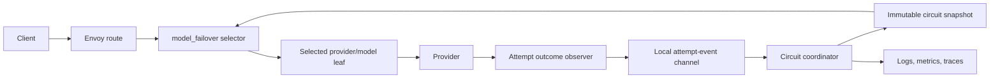
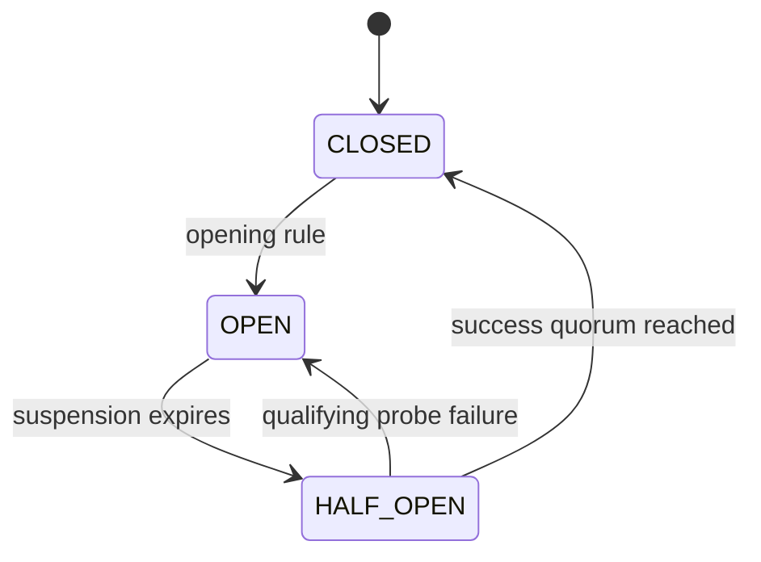

# LLM Model Failover — Remaining Gap Remediation Specification

**Status:** Proposed; safe policy-side repairs implemented  
**Scope:** Delta from the current suffix-composite POC to the complete production circuit breaker  
**Related architecture:** `2026-09-23-llm-model-failover-implementation-spec.md`  
**Source requirement:** `wso2-enterprise/wso2-apim-internal#18469`

## 1. Purpose

The current implementation successfully:

- routes a suspended prefix through a suffix composite;
- preserves the remaining chain after that prefix;
- fails fast when every member is blocked;
- tracks consecutive HTTP failures;
- evaluates rolling failure rate and p95 response latency;
- limits half-open traffic to one request;
- isolates health by model, provider, and upstream definition; and
- emits basic transition logs and fallback attribution.

This specification defines the work required to close the remaining correctness gaps found during code review. It is a delta specification: unchanged behavior remains governed by the main implementation specification.

### 1.1 Current implementation status

The low-risk fixes that fit the existing callback architecture are implemented:

- transport retry conditions remain enabled when custom HTTP status codes are configured;
- one attempt can open the circuit only once, even when several rules breach;
- late completions during an active suspension cannot extend backoff repeatedly;
- a lost half-open probe reopens the circuit instead of silently granting a replacement;
- three successful half-open probes are required before normal traffic resumes; and
- primary and fallback responses both receive selection analytics metadata.

The Envoy extension described below is still required to account transport failures in circuit state, skip an arbitrary open member inside a retry chain, and reject late probe results with generation-safe permits. The other open items are configurable thresholds, representative latency histograms, explicit lifecycle cleanup, and coordinated multi-replica state.

## 2. Remaining problems

| ID | Problem | Consequence |
|---|---|---|
| G1 | Transport failures never reach `OnResponseHeaders`. | Connection refusal, reset, timeout, and hung upstreams do not affect circuit state or half-open recovery. |
| G2 | Suffix composites skip only a suspended prefix. | An open member after an eligible member is still attempted or blocks access to later members. |
| G3 | One attempt can satisfy several opening rules. | Suspension streak and backoff can be incremented multiple times for one outcome. |
| G4 | Half-open outcomes are keyed only by target. | A late outcome from an expired probe can complete a newer probe incorrectly. |
| G5 | One successful probe closes the circuit. | A single lucky response can restore unrestricted traffic. |
| G6 | Window, percentile, breach count, and recovery controls are fixed constants. | Operators cannot tune the circuit to deployment traffic characteristics. |
| G7 | Latency samples use a first-N cap. | High-volume percentiles are biased toward the beginning of a bucket. |
| G8 | Selection telemetry is incomplete. | Primary selections and selection reasons cannot be audited consistently. |
| G9 | Registry cleanup is opportunistic and state is replica-local. | Deleted chains can retain state and replicas can disagree without an explicit consistency contract. |

## 3. Architectural decision

G1 and G2 cannot be fixed completely inside the current policy callback surface:

- the external-processing response-header callback is not invoked for an upstream transport failure with no response headers; and
- a stock Envoy composite cluster selects by retry attempt number and cannot consult policy circuit state between attempts.

The complete implementation therefore introduces one Envoy extension with two responsibilities:

1. **Retry-time target selection** from an ordered chain and immutable circuit snapshot.
2. **Per-attempt outcome publication** for HTTP and transport outcomes.

The extension must not own circuit thresholds or long-lived circuit state. The policy-runtime circuit coordinator remains the health authority.



Suffix composites remain available behind a compatibility flag until the extension is production-ready. They are explicitly a prefix-skip mode, not the final arbitrary-skip implementation.

## 4. Versioned shared contracts

Controller, Envoy extension, and runtime coordinator must share generated protobuf contracts. Handwritten copies of these wire structures are not allowed.

### 4.1 Chain definition

```proto
message FailoverChain {
  string chain_id = 1;
  uint64 config_generation = 2;
  repeated FailoverMember members = 3;
}

message FailoverMember {
  string target_id = 1;
  string model = 2;
  string provider_id = 3;
  string leaf_cluster = 4;
}
```

`target_id` is derived from policy scope, provider configuration, model, and—while still supported—upstream definition. It is opaque and safe for bounded telemetry labels.

### 4.2 Circuit snapshot

```proto
message CircuitSnapshot {
  uint64 generation = 1;
  uint64 config_generation = 2;
  map<string, TargetCircuitSnapshot> targets = 3;
}

message TargetCircuitSnapshot {
  CircuitState state = 1;
  string reason = 2;
  google.protobuf.Timestamp open_until = 3;
  ProbeLease probe_lease = 4;
}

enum CircuitState {
  CIRCUIT_STATE_UNSPECIFIED = 0;
  CLOSED = 1;
  OPEN = 2;
  HALF_OPEN = 3;
}

message ProbeLease {
  string permit_id = 1;
  uint64 generation = 2;
  google.protobuf.Timestamp expires_at = 3;
}
```

### 4.3 Attempt event

```proto
message AttemptEvent {
  string chain_id = 1;
  uint64 config_generation = 2;
  string target_id = 3;
  string request_id = 4;
  uint32 attempt_number = 5;
  AttemptOutcome outcome = 6;
  uint32 status_code = 7;
  google.protobuf.Duration latency = 8;
  bool streaming = 9;
  string probe_permit_id = 10;
  uint64 probe_generation = 11;
  google.protobuf.Timestamp completed_at = 12;
}

enum AttemptOutcome {
  ATTEMPT_OUTCOME_UNSPECIFIED = 0;
  SUCCESS = 1;
  HTTP_FAILURE = 2;
  CONNECT_FAILURE = 3;
  RESET = 4;
  TIMEOUT = 5;
  NO_HEALTHY_UPSTREAM = 6;
  CLIENT_CANCELLED = 7;
}
```

Exactly one terminal event is emitted for every selected upstream attempt.

## 5. Transport-outcome accounting

### 5.1 Outcome source

The Envoy extension observes the selected member's terminal upstream result through Envoy cluster/load-balancer and stream callbacks. It must distinguish:

- response headers received;
- connection establishment failure;
- upstream reset before response headers;
- per-try timeout;
- no healthy upstream;
- downstream/client cancellation; and
- successful response commitment.

The implementation must not infer transport failure from the final downstream status because retries can hide an earlier failed attempt.

### 5.2 Delivery

Attempt events are sent asynchronously over a local bounded channel or Unix-domain socket to the runtime coordinator.

- Selection never waits for event delivery.
- Events carry a stable request/attempt identity for deduplication.
- Buffer overflow increments a drop counter and logs a rate-limited warning.
- The coordinator ignores duplicate terminal events.
- An event with a stale `config_generation` cannot mutate the replacement chain.

### 5.3 Classification

Configuration explicitly controls whether each transport category qualifies as a circuit failure:

```yaml
failurePolicy:
  statusCodes: [429, 500, 502, 503, 504]
  includeConnectFailures: true
  includeResets: true
  includeTimeouts: true
  includeNoHealthyUpstream: true
  excludeClientCancellations: true
```

Client cancellation never penalizes a target unless an upstream failure was independently established first.

### 5.4 Route retry alignment

Envoy retry configuration and coordinator classification must be generated from the same normalized policy. Configuring `statusCodes` must not replace transport retry conditions.

For example:

```text
retry_on = retriable-status-codes,connect-failure,reset,reset-before-request
```

The exact conditions must be validated against the pinned Envoy version with real-Envoy tests. `per_try_timeout` must remain smaller than the overall request deadline with enough budget for the configured chain.

## 6. Arbitrary-member selection

### 6.1 Selector behavior

On each attempt, the Envoy selector:

1. reads request-local attempted target IDs;
2. reads the latest immutable circuit snapshot;
3. begins after the last actually selected chain position;
4. skips attempted targets;
5. skips `OPEN` targets;
6. skips `HALF_OPEN` targets without a valid probe permit;
7. selects the first eligible member; and
8. returns explicit failover exhaustion if none remains.

The selector never wraps and never selects a target twice in one request.

```text
for position in positionsAfter(lastSelectedPosition):
    member = chain[position]
    if member.targetId in attempted: continue
    state = snapshot[member.targetId]
    if state == OPEN: continue
    if state == HALF_OPEN and !validProbePermit(member): continue
    recordSelection(member)
    return member.leafCluster
return FAILOVER_EXHAUSTED
```

### 6.2 Required cases

```text
A=CLOSED, B=OPEN, C=CLOSED
```

If A fails, the next attempt is C.

```text
A=OPEN, B=CLOSED, C=OPEN, D=CLOSED
```

The first attempt is B; if B fails, the next attempt is D.

No suffix-composite configuration can be reported as satisfying these cases.

## 7. Single-transition circuit evaluation

One attempt event may update several signal accumulators, but may cause at most one state transition.

### 7.1 Evaluation order

Under the target lock:

1. Deduplicate the event.
2. If it belongs to an active probe permit, evaluate probe completion and stop.
3. Update consecutive counters.
4. Update the rolling failure-rate window.
5. Update the latency histogram.
6. Evaluate every enabled opening rule without mutating state.
7. Select one reason by deterministic precedence.
8. Apply exactly one transition and one backoff increment.
9. Publish one new snapshot generation.
10. Emit one transition event.

Recommended precedence:

```text
transport_failure
consecutive_failures
failure_rate_threshold
latency_threshold
```

The transition event contains all breached rules for diagnosis but one primary reason.

```go
type Evaluation struct {
    Open          bool
    PrimaryReason Reason
    Breached      []Reason
    Samples       int
    FailureRate   float64
    LatencyP95    time.Duration
}
```

Calling the suspension/backoff primitive more than once for the same attempt ID is forbidden.

## 8. Probe permits and controlled recovery

### 8.1 State machine



### 8.2 Permit identity

Every admitted probe receives:

- a cryptographically random `permit_id` or collision-resistant UUID;
- a monotonically increasing target probe generation;
- an expiry time; and
- the target and chain configuration generation.

The permit is placed in request-local Envoy filter state and copied to the attempt event.

The coordinator accepts a probe outcome only when all fields match the currently active lease. Outcomes from expired or replaced permits are recorded as stale and cannot close or reopen the circuit.

### 8.3 Recovery quorum

Recovery configuration is author-facing:

```yaml
recoveryPolicy:
  suspension: 60s
  maximumSuspension: 15m
  backoffMultiplier: 2
  jitterPercent: 20
  probeInterval: 5s
  maximumConcurrentProbes: 1
  successfulProbesToClose: 3
  failedProbesToReopen: 1
  probeLease: 15s
```

Successes must be consecutive within the current half-open generation. A failure resets the success count. Closing requires the configured quorum and a recovery latency threshold lower than the opening threshold.

Ordinary traffic continues through later eligible targets while a target is half-open and has no available permit.

### 8.4 Lost probes

When a permit expires without an event:

- mark the permit lost;
- count it as a timeout when the request was dispatched and no client cancellation is known;
- reopen or continue half-open according to `failedProbesToReopen`; and
- never let a late result complete a newer permit.

## 9. Configurable rolling evaluation

Replace fixed constants with validated policy configuration:

```yaml
failurePolicy:
  consecutiveFailures: 5
  failureRate:
    window: 60s
    buckets: 10
    minimumSamples: 20
    thresholdPercent: 40

latencyPolicy:
  metric: first-response-byte
  percentile: 95
  threshold: 2500ms
  minimumSamples: 20
  consecutiveBreachedWindows: 3
  recoveryThreshold: 1500ms
```

Validation rules:

- `window > 0`;
- `2 <= buckets <= 120`;
- `minimumSamples > 0`;
- percentage and percentile are within `1..100`;
- latency thresholds are positive;
- recovery threshold is lower than the opening threshold;
- consecutive breached windows are positive; and
- computed memory bounds fit the configured target limit.

### 9.1 Histogram

Use a bounded mergeable histogram such as HDR Histogram or DDSketch per time bucket. Do not retain the first N latency samples because that biases results under high traffic.

For streaming operations, the circuit latency signal is time to response headers or first token. Full-stream duration is a separate metric and does not trigger opening.

### 9.2 Consecutive breached windows

A latency window contributes one breached/not-breached result only after its minimum sample size is met. The circuit opens after the configured number of consecutive qualified breached windows. A qualified recovery window resets the breach streak.

## 10. Observability contract

### 10.1 Selection event

Emit one event for every selected attempt, including the primary:

```json
{
  "event": "llm_failover_target_selected",
  "chainId": "support-chat",
  "targetId": "t_7c91",
  "providerId": "azure-eastus",
  "model": "gpt-4o",
  "position": 0,
  "attempt": 1,
  "circuitState": "CLOSED",
  "reason": "primary",
  "probePermitId": ""
}
```

Selection reasons are bounded values: `primary`, `retry`, `open_skipped`, `half_open_probe`, and `prefix_compatibility`.

### 10.2 Transition event

Emit one event per actual transition, not per evaluation:

```json
{
  "event": "llm_target_circuit_transition",
  "targetId": "t_7c91",
  "from": "CLOSED",
  "to": "OPEN",
  "reason": "failure_rate_threshold",
  "breached": ["failure_rate_threshold", "latency_threshold"],
  "samples": 42,
  "failureRate": 0.43,
  "p95LatencyMs": 2800,
  "openUntil": "2026-09-23T10:31:00Z"
}
```

### 10.3 Metrics

- `llm_failover_selected_total{chain,target,position,reason}`
- `llm_failover_attempts_total{target,outcome}`
- `llm_failover_exhausted_total{chain}`
- `llm_circuit_state{target}`
- `llm_circuit_transitions_total{target,from,to,reason}`
- `llm_circuit_probe_total{target,outcome}`
- `llm_circuit_stale_probe_outcomes_total{target}`
- `llm_circuit_event_dropped_total{reason}`
- `llm_target_attempt_latency_seconds{target,mode}`
- `llm_circuit_snapshot_age_seconds`
- `llm_circuit_registry_entries`

Raw URLs, secrets, prompts, request IDs, and arbitrary client dimensions are not metric labels.

## 11. State lifecycle and consistency

### 11.1 Exact lifecycle

Controller snapshot application publishes chain registrations with `config_generation`. Snapshot removal explicitly unregisters chains after a bounded drain period. The coordinator then removes:

- circuit state;
- rolling histograms;
- probe leases;
- deduplication entries; and
- snapshot entries.

Idle garbage collection remains a safety net, not the primary deletion mechanism. It must run on a timer, not only when a new policy instance is created.

### 11.2 Replica mode

Configuration declares one mode:

```yaml
stateMode: local   # local | coordinated
```

`local` mode:

- each gateway replica owns independent circuit state;
- snapshots and probe limits are process-local; and
- telemetry includes `stateMode=local`.

`coordinated` mode:

- attempt events are aggregated by a shared coordinator;
- snapshots carry a fleet generation;
- probe permits are centrally leased; and
- replicas retain a last-known-good snapshot during coordinator disruption.

Local mode is acceptable for the initial release only when temporary replica disagreement is documented and accepted.

## 12. Configuration migration

The current flat fields are mapped as follows:

| Current field | New field |
|---|---|
| `statusCodes` | `failurePolicy.statusCodes` |
| `suspendAfterFailures` | `failurePolicy.consecutiveFailures` |
| `failureRateThresholdPercent` | `failurePolicy.failureRate.thresholdPercent` |
| `latencyThresholdMs` | `latencyPolicy.threshold` |
| `suspendDuration` | `recoveryPolicy.suspension` |
| `perTryTimeoutMs` | `retryPolicy.perTryTimeout` |

Because the policy is not released, the preferred migration is replacement rather than maintaining two permanent configuration surfaces. If compatibility is temporarily required, normalization occurs once in the controller and only the normalized protobuf reaches runtime components.

## 13. Implementation sequence

### Phase A — repair policy-side correctness

1. Refactor signal evaluation to one transition per attempt.
2. Introduce probe permit IDs and generations.
3. Add configurable recovery quorum.
4. Replace first-N latency storage with mergeable histograms.
5. Add timer-driven registry garbage collection.
6. Add primary and fallback selection telemetry.

These changes improve the current suffix mode but do not claim to solve G1 or G2.

### Phase B — shared contracts and transport events

1. Add versioned protobufs.
2. Implement coordinator event ingestion and deduplication.
3. Implement transport outcome publication in the Envoy extension.
4. Generate aligned HTTP and transport retry conditions.
5. Verify connection refusal, reset, and timeout with real Envoy.

### Phase C — authoritative selector

1. Implement request-local attempted-target filter state.
2. Read immutable circuit snapshots at each selection.
3. Skip arbitrary open members.
4. Validate and consume half-open permits.
5. Emit explicit exhaustion when no target is eligible.
6. Remove policy-side cluster selection when the feature flag is enabled.

### Phase D — lifecycle and coordinated mode

1. Add explicit chain register/unregister hooks.
2. Add periodic safety-net GC.
3. Add coordinated snapshot and lease mode if fleet consistency is required.
4. Remove suffix compatibility mode after migration.

## 14. Verification plan

### 14.1 Policy/coordinator unit tests

- one event breaching three rules produces one transition and one backoff increment;
- duplicate event IDs are ignored;
- twenty samples are required when configured;
- failure-rate threshold respects bucket expiry;
- latency requires configured consecutive qualified windows;
- histogram remains representative above the previous 200-sample cap;
- one probe success does not close when quorum is three;
- three valid successes close when quorum is three;
- failure resets the probe success count;
- stale permit outcome cannot complete a replacement permit;
- lost probe follows configured timeout behavior; and
- config-generation mismatch cannot mutate current state.

### 14.2 Selector unit tests

- `CLOSED, OPEN, CLOSED` selects positions `0`, then `2`;
- `OPEN, CLOSED, OPEN, CLOSED` selects positions `1`, then `3`;
- attempted members never repeat;
- selection never wraps;
- half-open without a permit is skipped;
- half-open with the matching permit is selected;
- expired or wrong-generation permit is rejected; and
- all blocked returns exhaustion.

### 14.3 Real-Envoy integration tests

Mocks alone are insufficient.

1. Connection refusal retries the next member and records `CONNECT_FAILURE`.
2. TLS/connect reset retries and records `RESET`.
3. A connected backend sending no headers is terminated at `per_try_timeout`, retries, and records `TIMEOUT`.
4. Configured `429` retries while transport conditions remain enabled.
5. A transport-failed half-open probe reopens immediately.
6. A stale probe response cannot close a newer probe generation.
7. An internal open member is skipped and a later member succeeds.
8. Streaming traffic is never retried after response commitment.
9. Primary selections and every fallback attempt emit audit telemetry.
10. Route deletion removes coordinator and snapshot state after drain.

### 14.4 Concurrency and performance tests

- run coordinator and selector tests under the race detector;
- prove the configured concurrent probe ceiling under load;
- prove one terminal event per attempt under reset races;
- measure selector p99 overhead;
- verify event-channel backpressure does not block inference; and
- verify bounded memory across maximum routes, targets, buckets, and replicas.

## 15. Acceptance criteria

The remaining-gap work is complete only when:

1. HTTP and transport outcomes use the same circuit authority;
2. connection failure, reset, timeout, and hung upstreams can open and reopen a circuit;
3. configuring HTTP status codes does not disable transport failover;
4. arbitrary open members are skipped while later members remain reachable;
5. one attempt causes at most one circuit transition and backoff increment;
6. stale probe outcomes cannot mutate a newer half-open generation;
7. recovery requires the configured success quorum;
8. rolling criteria and recovery controls are validated and configurable;
9. latency percentiles remain representative under high volume;
10. every attempt, including the primary, is auditable;
11. route deletion explicitly removes state;
12. replica consistency mode is explicit; and
13. all real-Envoy cases in §14.3 pass.

## 16. Repository change map

Expected implementation areas:

- `gateway/dev-policies/model-failover/` — normalized configuration, single-transition evaluation, telemetry, and compatibility-mode removal;
- `gateway/gateway-controller/pkg/transform/model_failover_policy.go` — nested validation and normalized retry classification;
- `gateway/gateway-controller/pkg/models/runtime_deploy_config.go` — normalized chain and circuit contracts;
- `gateway/gateway-controller/pkg/xds/failover_cluster.go` — selector cluster generation;
- `gateway/gateway-controller/pkg/xds/translator.go` — aligned retry conditions and feature flag;
- `gateway/gateway-controller/pkg/policyxds/` — chain registration and removal lifecycle;
- `gateway/gateway-runtime/` — circuit coordinator, event ingestion, snapshots, metrics, and timer-driven GC; and
- the Envoy extension build area — retry-time selection and transport-outcome observation.

## 17. Out of scope

- provider endpoint or deployment fields in failover policy configuration;
- regional load balancing while the primary is healthy;
- retrying after response headers or streaming bytes are committed;
- prompt-aware or user-specific circuit state;
- synchronous coordinator calls on the inference request path; and
- treating suffix-composite compatibility mode as full arbitrary-member failover.
