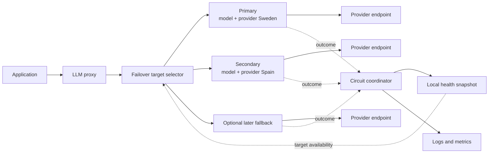
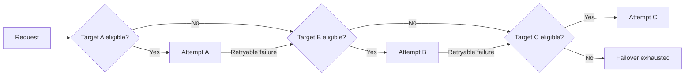
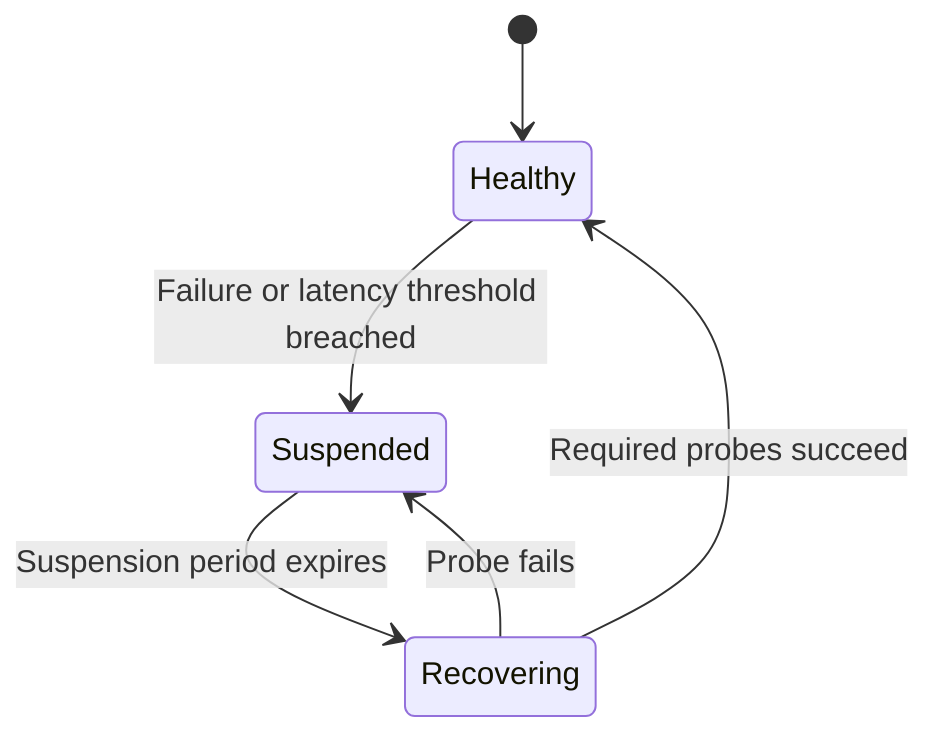

# Reliable LLM Model Failover — Design Proposal

**Status:** Proposed  
**Related issues:** `wso2/api-platform#3356`, `wso2-enterprise/wso2-apim-internal#18469`  
**Audience:** Architecture, Gateway, AI Platform, SRE, and Product teams

## Section 1: What is the problem we are trying to solve? And why should it be solved now?

Applications using an LLM proxy become unavailable when their selected model, provider, or provider region becomes slow, rate-limited, or unavailable. Application developers currently have to detect these failures, select another model or region, apply different authentication and request formats, and retry from every client application.

This should be solved now because ECI has requested automatic failover between its Azure AI Foundry deployments in Sweden and Spain. The capability also closes a product gap: the gateway can perform basic model retries, but it does not yet provide complete degradation detection, temporary suspension, safe recovery, and reliable traversal of a multi-target fallback chain.

## Section 2: Who are we solving the problem for?

### Primary users

- **Application developers** using an LLM proxy who need their applications to remain available without implementing provider-specific fallback logic.
- **AI platform administrators** who configure approved models, providers, and regional fallback order centrally.
- **Site reliability and operations teams** who need to identify degraded targets, understand failover decisions, and verify recovery.

### Initial customer scenario

ECI uses an Azure AI Foundry deployment in Sweden as its primary target and a deployment in Spain as its secondary target. The objective is active/passive regional protection: Spain should receive traffic only when Sweden is degraded or while Sweden is being tested for recovery.

### Expected user experience

An administrator configures an ordered list of model and provider combinations. Applications continue calling the same LLM proxy and model name. The gateway automatically selects an eligible target, fails over when necessary, temporarily avoids degraded targets, and safely returns traffic to a recovered primary.

## Section 3: Solution

### 3.1 Solution overview

Introduce a model-failover policy that defines an ordered chain of model and provider combinations. The gateway evaluates the health of every target independently and selects the first eligible target for each request attempt.

The solution separates two responsibilities:

- **Target selection:** Envoy selects the next eligible target on every attempt and ensures that a request never repeats or wraps through the chain.
- **Health evaluation:** A circuit coordinator evaluates request outcomes over time and marks each target as healthy, suspended, or recovering.

The request path reads a local health snapshot. It does not wait for a synchronous call to the coordinator.



### 3.2 Target configuration and identity

Each chain member contains a model and a provider configuration reference. The provider configuration owns the endpoint, region, deployment name, credentials, API version, TLS configuration, and provider-specific transformations.

This allows the same model to be configured more than once through different provider configurations:

```text
gpt-4o / azure-sweden -> gpt-4o / azure-spain
```

Health is tracked using the policy scope, provider configuration, and model. A problem affecting one model or one regional provider configuration therefore does not automatically suspend unrelated targets.

### 3.3 Target selection and failover

For every upstream attempt, the gateway:

1. starts after the last target attempted by the request;
2. skips targets already attempted;
3. skips suspended targets;
4. selects a recovering target only when a controlled probe is allowed;
5. selects the next eligible target; and
6. returns a clear failover-exhausted response if no target remains.

Selection never returns to an earlier target and never attempts the same target twice within one request.



This behavior is important when an unavailable target is in the middle of a chain. For example, if `A` is healthy, `B` is suspended, and `C` is healthy, a failure from `A` must lead directly to `C`.

### 3.4 Failure detection

The policy supports the following failure signals:

- selected HTTP status codes, including `429` and configured `5xx` responses;
- connection failures;
- upstream connection resets;
- per-attempt timeouts;
- unavailable upstream targets; and
- aggregated response latency.

Client cancellation is not treated as a provider failure unless an upstream failure was independently established.

A single isolated failure should not normally suspend a target. Administrators can configure:

- consecutive qualifying failures;
- failure percentage over a rolling time window;
- minimum sample size before evaluating failure rate;
- latency percentile and threshold;
- minimum latency samples; and
- consecutive breached latency windows.

If one attempt breaches multiple rules, it produces only one circuit-state change.

### 3.5 Suspension and controlled recovery

Each target has three health states:



- **Healthy:** Eligible for normal traffic.
- **Suspended:** Skipped for a configurable period.
- **Recovering:** Receives limited probe traffic while normal requests continue through later eligible targets.

Recovery requires a configurable number of successful probes. A failed probe suspends the target again. Probe results are associated with a specific recovery cycle so that a late response from an older probe cannot change the current target state.

Repeated incidents use a bounded suspension backoff to avoid sending frequent probes to a persistently unhealthy provider.

### 3.6 Request timeout, retry, and streaming behavior

Each attempt has a timeout so a slow target cannot consume the entire client request deadline. Configuration validation ensures the overall deadline leaves a realistic opportunity to reach later targets.

Failover is allowed only before the response is committed to the client. Once response headers or streamed content have been sent, the gateway returns the active response and does not switch providers.

The policy may be attached only to operations that are safe to replay. Retry count is bounded by the configured chain length.

### 3.7 User-facing configuration

The following illustrates the intended configuration shape. Exact field names can be finalized during API review.

```yaml
targets:
  - model: gpt-4o
    provider: azure-sweden
    fallbacks:
      - model: gpt-4o
        provider: azure-spain

failurePolicy:
  statusCodes: [429, 500, 502, 503, 504]
  consecutiveFailures: 5
  failureRate:
    window: 60s
    minimumSamples: 20
    thresholdPercent: 40

latencyPolicy:
  percentile: 95
  threshold: 2500ms
  minimumSamples: 20
  consecutiveBreachedWindows: 3

recoveryPolicy:
  suspension: 60s
  successfulProbesToClose: 3

retryPolicy:
  perTryTimeout: 10s
```

Advanced settings such as measurement bucket count, maximum suspension, jitter, and probe concurrency receive safe platform defaults and remain optional.

### 3.8 API specification

The solution does not introduce a new public runtime API. The model-failover policy configuration is the user-facing contract and is deployed through the existing API and LLM proxy configuration workflow.

The policy schema must validate:

- at least one primary and one fallback;
- valid provider references;
- no duplicate model/provider member within one chain;
- valid percentages, durations, sample sizes, and retry limits;
- sufficient total timeout for the configured attempt budget; and
- attachment only to operations declared safe for retry.

Unknown configuration fields should be rejected so misspelled safety settings cannot silently use defaults.

### 3.9 Persistent data impact

No new customer-facing database schema is required for the initial release. Circuit state, rolling measurements, and probe state are runtime data and can remain local to each gateway instance.

Policy configuration remains in the existing API configuration. Runtime state is removed when the policy is removed or replaced. A future coordinated-state mode may require an external state service, but that is not part of the initial release.

### 3.10 Observability

The gateway records a target-selection event for every attempt, including the primary. It includes the chain, selected target, provider, model, attempt number, selection reason, outcome, and latency.

The gateway also records circuit-state changes, including:

- previous and new states;
- the reason for suspension or recovery;
- relevant sample count, failure rate, or latency percentile; and
- suspension and recovery timing.

Minimum metrics cover target selections, attempt outcomes, failover exhaustion, circuit transitions, and recovery probes. Credentials, endpoint URLs, prompts, and arbitrary request values are never used as metric labels.

### 3.11 Alternatives considered

#### Route directly to one fallback

This is simple but incomplete. If the selected fallback also fails, the remaining chain is no longer available.

#### Generate one suffix chain per position

This can skip an unavailable prefix and preserves later targets. Configuration grows linearly with chain length, so it is a reasonable short-term improvement.

However, it cannot reliably skip a suspended member in the middle of the remaining chain. Once a request enters a suffix, retry progression is based on attempt position rather than the current health of every candidate.

#### Use native Envoy outlier detection only

Native outlier detection is valuable for transport health, but it does not provide the required aggregated latency rules, target-level recovery probes, or complete middle-member selection behavior. It cannot be the sole circuit authority for this feature.

#### Call an external health service during every request

This would simplify shared state but add latency and make LLM request availability depend on another network service. A local read-only snapshot avoids that synchronous dependency.

### 3.12 Design surprises

The non-obvious requirement is not simply retrying the next configured target. A target that failed on an earlier request may appear anywhere in the remaining chain. The gateway must evaluate eligibility again for every attempt, not only when the request first enters the chain.

Another important distinction is between an HTTP failure and a transport failure. A connection refusal, reset, or timeout may occur without response headers, so response-policy callbacks alone cannot provide complete circuit-breaker signals.

## Section 4: Challenges, constraints, and how the solution handles them

### 4.1 Security considerations

#### Internal routing information

Clients must not be able to provide or override internal target, attempt, probe, or circuit identifiers. The gateway removes conflicting inbound headers and stores routing metadata in trusted request-local state.

#### Provider credentials

Each attempt uses credentials from the selected provider configuration. Credentials are not copied into policy configuration, logs, metrics, or circuit state.

#### Configuration and control-plane communication

Failover configuration uses the existing authenticated control-plane-to-gateway configuration channel. Configuration is validated before activation and carries a generation so outcomes from an older policy cannot affect its replacement.

#### User-provided code

The feature does not execute user-provided code. Users supply declarative policy configuration only.

#### Data exposure across providers

Cross-provider failover sends the prompt to another configured provider. Administrators must explicitly configure and approve every fallback provider so data residency and contractual requirements remain visible.

### 4.2 Cloud cost considerations

Retries can increase inference charges because a failed attempt may still consume provider resources or tokens. The solution limits this exposure through bounded chain length, one attempt per target, per-attempt timeouts, and no retry after response commitment.

The initial replica-local state model requires no external datastore. The main infrastructure cost is the small amount of bounded memory and processing needed for rolling health measurements and telemetry on each gateway instance.

### 4.3 Cloud-native considerations

- **Horizontal scaling:** Each gateway replica can evaluate local outcomes and route independently.
- **Failure isolation:** The request path continues using the last known local snapshot if health updates are temporarily delayed.
- **Bounded resources:** Chain length, measurement windows, target count, retry concurrency, and telemetry buffers have platform limits.
- **Lifecycle:** Deploying, replacing, or removing a policy creates or removes the corresponding runtime health state.
- **Observability:** Metrics expose target health, retry volume, exhausted chains, dropped events, and snapshot age.
- **Graceful rollout:** Existing requests finish against their configuration generation while new requests use the replacement.

### 4.4 Limitations imposed by the current architecture

Envoy's position-based composite routing can advance through an ordered chain, but it cannot reliably reconsider arbitrary target health before each attempt. A complete solution therefore requires a narrowly scoped Envoy selection capability that understands ordered members and a local circuit snapshot.

If changing the Envoy distribution is not immediately possible, suffix chains can be delivered as an interim mode. That mode must be documented as supporting unavailable-prefix skipping rather than complete arbitrary-member skipping.

Circuit state is local to each gateway replica in the initial release. Replicas may temporarily disagree about target health because they observe different traffic. This is acceptable only if documented and observable; fleet-wide coordinated state can be added when a customer requirement justifies its operational cost.

### 4.5 Performance and latency

LLM requests are latency-sensitive and often long-lived. Target selection therefore performs only local reads and never waits for the coordinator, control plane, or an external datastore.

Outcome processing and telemetry are asynchronous and bounded. If their buffers are full, the gateway records dropped-event metrics rather than delaying inference traffic. Health snapshots are immutable for readers so selection remains low-contention under concurrency.

Per-attempt timeout and the overall request deadline are treated separately. This prevents a slow primary from consuming the time needed to reach a healthy fallback.

### 4.6 Main trade-offs

| Decision | Benefit | Cost or limitation |
|---|---|---|
| Evaluate eligibility on every attempt | Correctly skips any suspended member | Requires a focused Envoy selection capability |
| Keep selection snapshots local | No request-path network dependency | Replicas can briefly disagree |
| Use aggregated health signals | Avoids failover from isolated errors | Detection is intentionally slower than single-error failover |
| Use controlled recovery | Prevents a traffic surge to an unstable target | Recovery takes several successful probes |
| Allow cross-provider fallback | Improves availability | May increase cost and requires explicit data-governance approval |
| Require replay-safe operations | Prevents unsafe duplicate processing | Some operations cannot use automatic failover |

### 4.7 Scaling with Choreo, Asgardeo, and product deployments

The policy uses provider references and gateway-local runtime state, so the same contract can be used by self-managed API Platform gateways and managed gateway environments.

For larger managed deployments, a coordinated circuit-state mode can later aggregate outcomes across replicas and issue global probe permits. This should remain optional: it improves fleet consistency but introduces an external availability and cost dependency.

Identity and access control continue through the existing platform and provider configuration mechanisms. No failover-specific identity service integration is required.

### 4.8 Validation and release criteria

Before release, the solution must demonstrate that:

1. the same model can fail over between different regional provider configurations;
2. HTTP failures, connection failures, resets, and timeouts contribute to target health;
3. aggregated failure and latency rules respect minimum sample sizes;
4. an unavailable member in any chain position is skipped while later targets remain reachable;
5. a target is never attempted twice in one request;
6. half-open recovery limits traffic and requires the configured success count;
7. late probe outcomes cannot modify a newer recovery cycle;
8. streaming responses are not retried after commitment;
9. all-target exhaustion returns a consistent response; and
10. target selections and circuit changes are visible in logs and metrics.

